# usb2ip

**Get one ready-built:** [usb2ip at Forbes Automotive](https://forbes-automotive.com/products/usb2ip?utm_source=github&utm_medium=readme&utm_campaign=usb2ip) · More boards and guides at [forbes-automotive.com](https://forbes-automotive.com/?utm_source=github&utm_medium=readme&utm_campaign=usb2ip).

**A wireless USB/IP bridge and live-gauge dashboard for an aftermarket ECU, powered by an ESP32-S3.**

usb2ip lets a Windows laptop talk to a USB ECU (*Ignitron*) **over WiFi** using the standard
[USB/IP](https://usbip.sourceforge.net/) protocol, so no cable to the car is needed. The built-in web
dashboard shows live engine gauges. When you *do* want a wired connection, plug a USB-C cable into the
piggyback port and the board hands the ECU straight to your laptop, stepping the WiFi bridge out of the way.

An automotive-grade buck supply runs the whole thing from the car, and a 5-minute idle timer powers
everything down so nothing is left energised.

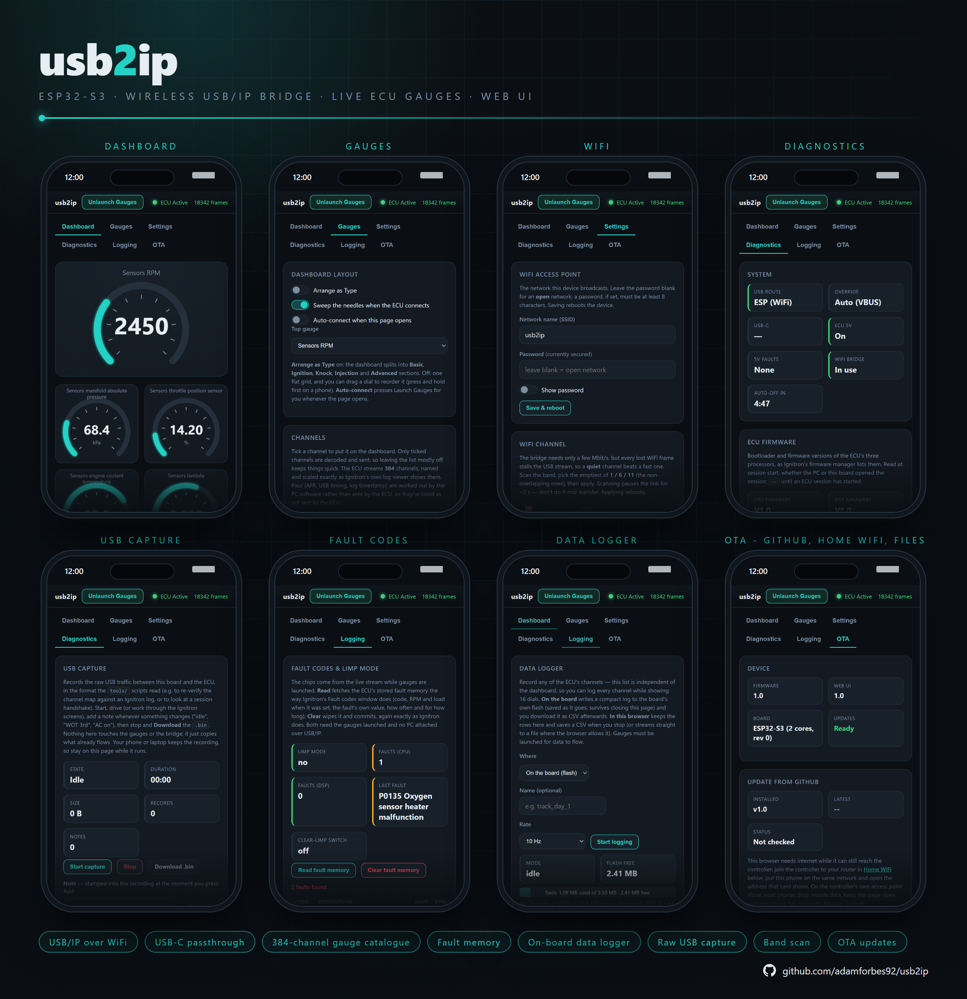

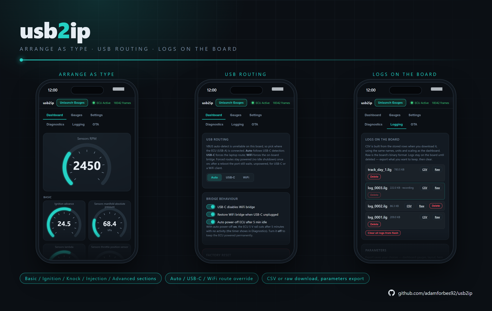

---

## Features

- **Wireless USB/IP bridge**: the ESP32-S3 hosts the ECU on its native USB and exports it over its own
  WiFi access point on TCP `3240`. Attach it on the laptop with `usbip` / `usbip-win2`.
- **Piggyback USB-C passthrough**: plug a laptop into the USB-C port and an FSUSB42 chip routes the ECU
  directly to the laptop at full speed.
- **Live web gauges**: a dark, phone-friendly dashboard served straight from the board. Any of the ECU's
  384 channels, named and scaled exactly as Ignitron's own log viewer shows them (the catalogue is
  extracted from `Ignitron.exe`, and the wire layout is verified byte-for-byte against a real log).
- **Automatic USB switching**: senses USB-C going in and out and switches the ECU between the ESP and
  USB-C on its own.
- **5-minute idle shutdown**: with no WiFi activity the ECU's 5V rail is cut, so the ECU sees an
  unplugged host and draws nothing.
- **Fault codes and data logging**: read and clear the ECU's stored fault memory, and log any channels to
  the board's flash or straight into the browser.
- **Status LED**: slow flash = nothing on USB-A, double blink = device connected and idle, fast blink =
  transferring, solid = handed to USB-C.
- **Raw frame tap**: a second TCP port (or the dashboard) records every raw ECU transfer.
- **OTA updates**: from GitHub or from files, over WiFi.

---

## Getting started (Windows)

The Ignitron ECU is a **Microchip USB device driven by `libusb-win32`** (installed by the Ignitron tuning
software or Zadig). Over WiFi it appears as a *virtual* USB device, so you need the USB/IP client **and**
that same driver bound to it.

1. **Install the USB/IP client**: [usbip-win2](https://github.com/vadimgrn/usbip-win2). Its driver is
   test-signed, so from an **admin** prompt:

   ```powershell
   bcdedit /set testsigning on   # then reboot
   .\usbip.exe install           # run from the extracted release: installs vhci + cert
   ```

2. **Join** the `usb2ip` WiFi network. It is **open** by default (no password); set a name and password
   later on the **Settings** tab. The board is at **`192.168.1.1`**.
3. **List, then attach** the ECU:

   ```powershell
   usbip list   -r 192.168.1.1        # should show bus id 1-1
   usbip attach -r 192.168.1.1 -b 1-1
   ```

4. **Driver binding**: the virtual device carries the ECU's real Microchip VID/PID, so Windows binds the
   existing `libusb-win32` driver automatically and it shows up under *libusb-win32 devices* in Device
   Manager, exactly like a local connection. If it asks for a driver instead, run **Zadig** once and
   install `libusb-win32` for that device.
5. **Launch the Ignitron software**: it finds the ECU as if plugged in locally.
6. **Detach** when done: `usbip detach -p 0`.

The dashboard is at **<http://192.168.1.1>** whether or not a laptop is attached.

### Supported USB devices

The bridge is class-agnostic: whatever the ESP32-S3 full/low-speed host can enumerate is exported
unchanged, and the driver on the laptop talks to it as if it were local. Verified transfer paths cover
**mass storage**, **HID** (keyboards, mice: interrupt-IN URBs stay pending indefinitely, as the HID stack
expects), **printers** (large bulk-OUT jobs are streamed straight from the socket, no size limit),
**CDC / FTDI / vendor serial cables** (short vendor control reads, the always-pending bulk-IN read) and
**vendor bulk devices** such as the ECU, including composite devices and interfaces with alternate
settings.

Four standard requests are handled on the bridge rather than forwarded raw: `SET_CONFIGURATION`,
`SET_INTERFACE`, `CLEAR_FEATURE(ENDPOINT_HALT)` and the `SET_FEATURE(PORT_RESET)` a USB/IP client sends
to mean "reset this device" (usbip-win2 issues it for every Windows `IOCTL_INTERNAL_USB_RESET_PORT`, e.g.
FTDI's `FT_ResetPort` and the FTDI driver's own error recovery). That is exactly the set the Linux `usbip`
stub driver intercepts. Each resets endpoint data toggles on the device, and ESP-IDF can only mirror that
by tearing down and re-creating the interface's pipes; the bridge does that transparently, cancelling and
resubmitting any URB a driver keeps parked on the interface meanwhile.

Limits: one device at a time, no isochronous endpoints (audio/video), at most 7 data endpoints (DWC
host-channel count), and IN URBs up to 64 KB.

---

## Web dashboard

| Tab | What's on it |
|-----|--------------|
| **Dashboard** | Animated radial gauges: a big top dial (RPM by default, selectable) plus whatever channels are ticked on the Gauges tab. In the flat layout, drag a dial to reorder (press and hold first on a phone); the order is saved on the board. **Arrange as Type** splits the grid into Basic / Ignition / Knock / Injection / Advanced sections instead |
| **Gauges** | The layout switches (Arrange as Type, needle sweep on connect, auto-connect on page open, which gauge owns the top dial) and the 384-channel catalogue in six dropdowns, ticked on or off (16 on at once) |
| **Settings** | WiFi access point name and password, WiFi channel scan, USB routing, bridge behaviour, factory reset |
| **Diagnostics** | System chips (USB-C / ECU 5V / route / auto-off countdown), the ECU's own COM/DSP/CPU bootloader and firmware versions, board firmware, free memory, ECU link and frame count, the USB connectivity trace and the [raw frame capture](#raw-frame-capture) recorder |
| **Logging** | The data logger, logs on the board, parameters export / import, and fault codes & limp mode |
| **OTA** | Firmware and web UI versions, update from GitHub, Home WiFi (bridge mode), update from files |

<p align="center">
  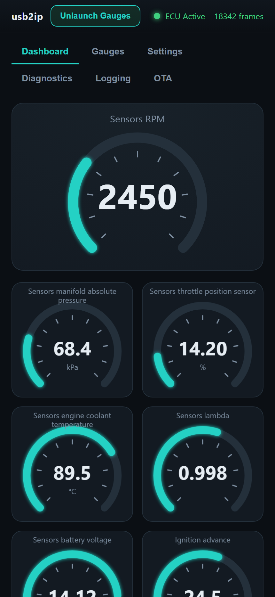
  &nbsp;
  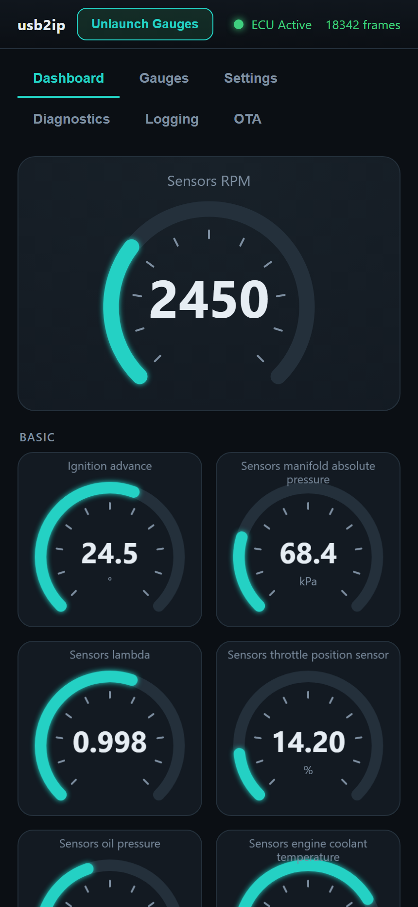
  &nbsp;
  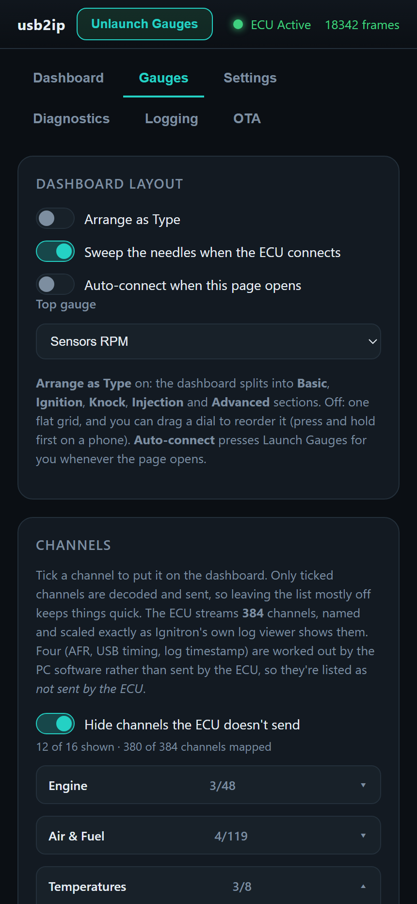
</p>

*Dashboard (left), the same dials with Arrange as Type (middle), and the Gauges tab (right).*

<p align="center">
  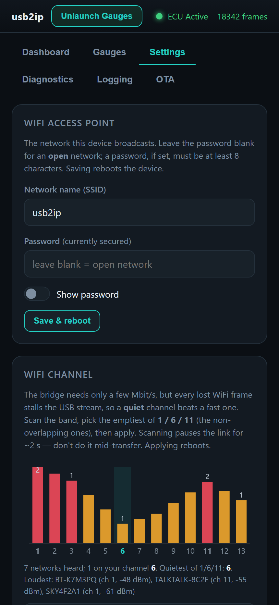
  &nbsp;
  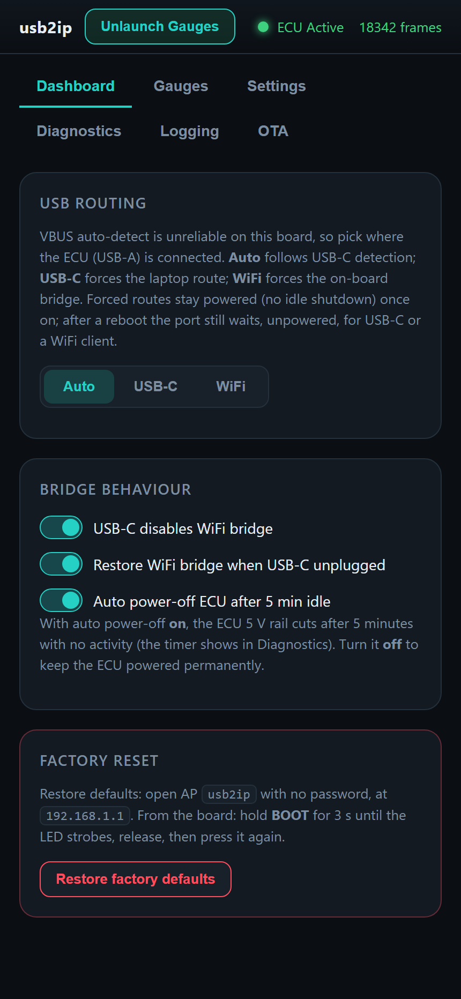
  &nbsp;
  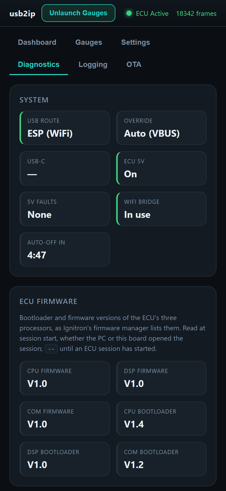
</p>

*Settings: WiFi and the channel scan (left), USB routing and bridge behaviour (middle). Diagnostics (right).*

<p align="center">
  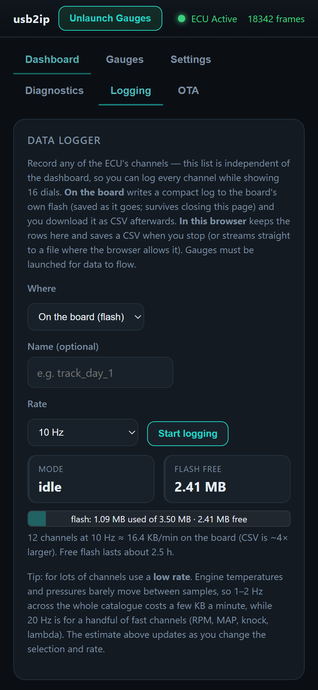
  &nbsp;
  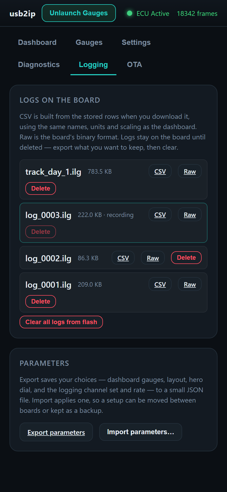
  &nbsp;
  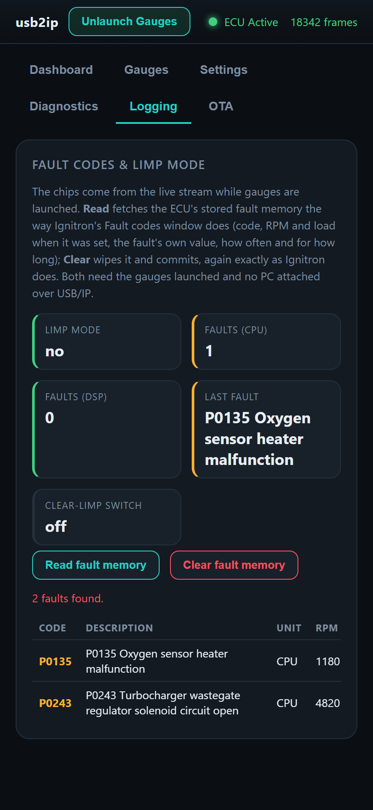
</p>

*Logging: the data logger (left), logs on the board (middle) and the ECU's fault memory (right).*

<p align="center">
  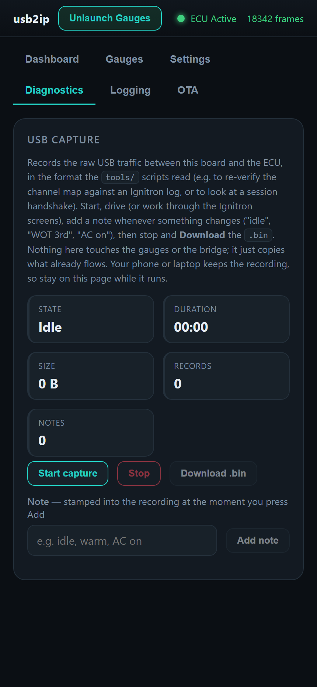
  &nbsp;
  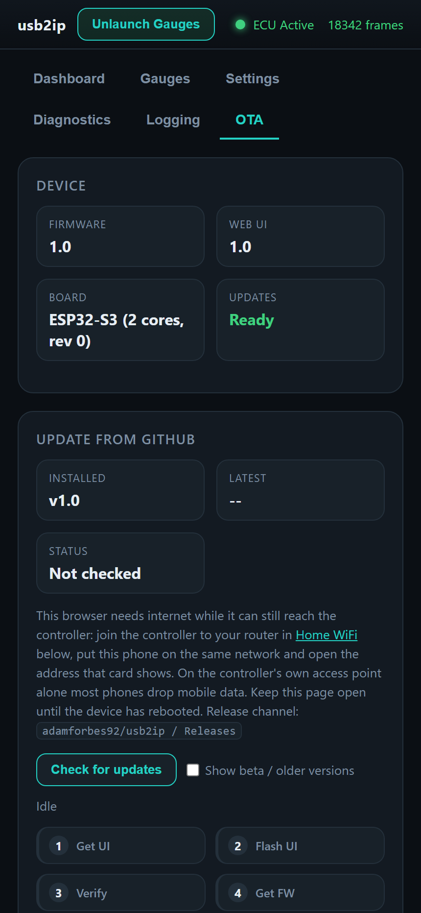
</p>

*The USB capture recorder on the Diagnostics tab (left) and the OTA tab (right).*

### Settings

- **WiFi access point**: edit the name and password. Leave the password blank for an **open** network; a
  password, if set, must be **at least 8 characters** (WPA2 minimum). Saving reboots the board to
  re-broadcast the access point.
- **WiFi channel**: scan the 2.4 GHz band and move the access point to the quietest of 1 / 6 / 11.
- **USB routing**: pin the ECU to the WiFi bridge or the USB-C port instead of following USB-C detection.
- **Bridge behaviour**: **USB-C disables WiFi bridge** (stage 2) and **Restore WiFi bridge when USB-C
  unplugged** (stage 3), plus the 5-minute auto power-off.
- **Factory reset**: back to the open `usb2ip` access point (no password) at `192.168.1.1`.

Settings are kept on the board through power cuts.

### Logging

The **Logging** tab records any set of the ECU's channels. It has its own selection, separate from the
dashboard's 16-dial limit: any number of channels up to all 384, at 1 to 20 Hz. *Select main* takes every
measurement and leaves out the 29 status-bit words; *Select all* takes everything.

- **On the board**: rows go to the board's flash, flushed every 2 s, so a power cut costs at most that.
  Give a log a name or take the running number; logs stay until deleted (one at a time or *Clear all logs
  from flash*), and the tab shows a flash-usage bar plus a live estimate of how long the free space lasts
  at the current selection and rate. Keeps recording with the page closed. Download as **CSV** (with the
  same names, units and scaling as the dashboard) or the raw file. Budget: 20 channels at 10 Hz is about
  1.6 MB an hour; all 384 at 10 Hz is about 28 MB an hour, i.e. around 7 minutes of the ~3.3 MB free, so
  pick a lower rate for full-catalogue logs on the board, or log in the browser.
- **In this browser**: the page samples at the chosen rate. Where the browser supports it (Chrome / Edge)
  rows stream straight into a file you pick; otherwise they are held and saved as CSV when you stop.

**Parameters** export / import (same tab) saves the dashboard gauge set, layout, top dial and the logging
channel set and rate as a small file.

The same tab carries the **Fault codes & limp mode** card: live limp / fault-count chips from the stream,
plus **Read** and **Clear** of the ECU's stored fault memory, exactly as Ignitron's Fault codes window
does it.

### Factory reset

Besides the **Settings → Factory reset** button: hold **BOOT** for **3 s** until the LED strobes,
**release, then press it again** within 3 s. That wipes the WiFi details, routing override and behaviour
settings and reboots to the open access point. Holding it without the second press does nothing.

> [!NOTE]
> The **EN** button is the ESP32's hardware reset and can't be read by the firmware, so **BOOT** (GPIO0) is
> used instead. GPIO0 is also driven by the console CH340's DTR line, which is why a plain long press isn't
> enough: a serial terminal asserting DTR would otherwise factory-reset the board.

### OTA updates

Everything happens on the **OTA** tab; USB is only needed for the very first install, or if the web
interface is ever lost.

- **Update from GitHub**: press **Check for updates**. The page reads the release list from
  [`adamforbes92/usb2ip`](https://github.com/adamforbes92/usb2ip) (`Releases/releases.json` plus the `V…`
  folders), shows *Installed* vs. *Latest* (older and beta releases sit behind a tick-box, for rolling
  back), then installs the selected version in six tracked steps: download and flash the web UI, verify
  it, download and flash the firmware, reboot. The browser needs internet *while it can still reach the
  board*: join the board to your router in the **Home WiFi (Bridge Mode)** card, put the phone on the same
  network and open the address the card shows (`http://usb2ip.local/` works there too). On the board's own
  access point alone most phones drop mobile data.
- **Home WiFi (Bridge Mode)**: the board joins a home or garage network alongside its own access point.
  Scan or type the network name, save, and once it shows *Connected* the board is reachable from that
  network as well. It tries hard for 20 s after boot, then once every 5 minutes, so a saved network can't
  disturb the access point when the car is parked away from home.
- **Update from Files**: no internet needed. Download `littlefs.bin` and `firmware.bin` from the newest
  `Releases/V…/` folder and upload them here, **Filesystem** (web UI) first, then **Firmware**. The board
  reboots after the firmware.

Every upload is size-checked, and a filesystem image is checked by mounting it before the board reports
success; a failed filesystem upload is wiped rather than left half-written. If the web interface is ever
missing (a filesystem update that stopped part-way), the board serves a **recovery page** at its address
with the same two uploads, so it is never a USB job. An update also holds off the 5-minute idle shutdown,
so the ECU rail can't be cut mid-write.

---

## Hardware

Custom ESP32-S3 board: **WROOM-1-N16R8** (LCSC C2913202), 16 MB flash and 8 MB octal PSRAM. The PSRAM is
fitted but left switched off: the USB host's DMA needs internal memory, and GPIO35 to 37 are the PSRAM
bus, so nothing else uses them. Power comes from the car through an input-protected buck (TPS62933,
6.5 to 24 V → 5 V) and an AMS1117 3.3 V regulator. The ECU lives on a **USB-A** port whose 5V is a
switched rail; a **USB-C** port is the piggyback laptop connection. The two 5V sources are joined through
CH213K ideal-diode e-fuses.

### GPIO map

| GPIO | Net | Direction | Function |
|-----:|-----|-----------|----------|
| **4**  | `ESP_LED`      | out | Status LED (active-HIGH) |
| **5**  | `USB_OE`       | out | FSUSB42 `/OE`: HIGH = mux off (USB-A floating) |
| **6**  | `USB_SEL`      | out | FSUSB42 `SEL`: LOW = ESP host, HIGH = laptop (USB-C) |
| **7**  | `IGNITRON_PWR` | out | TPS2041B `EN#` (ECU 5V switch): **active-LOW**, 10 k pull-up = off |
| **8**  | `VBUS_SENSE`   | in  | USB-C VBUS present (LVC1G17 buffered), HIGH = C plugged; shared by **both** USB-C ports |
| **16** | `IGNITRON_OC`  | in  | TPS2041B `OC#`: LOW = over-current / thermal fault on USB-A |
| **19** | `ESP_IGNITRON_D-` | | Native USB D− to ECU (via mux) |
| **20** | `ESP_IGNITRON_D+` | | Native USB D+ to ECU (via mux) |
| **43** | `TXD0` | out | Serial console TX → CH340 RX |
| **44** | `RXD0` | in  | Serial console RX ← CH340 TX |

> [!WARNING]
> **`IGNITRON_PWR` (GPIO7) is active-LOW.** It drives the `EN#` pin of the TPS2041B (U10) USB power
> switch, which has a 10 kΩ pull-up to 3V3. Firmware turns the rail on with `OUTPUT` + `LOW` and off by
> returning the pin to `INPUT` (floating). Reset default (floating) = ECU off. Floating rather than HIGH is
> kept so the same firmware stays safe on a rev1 board (AO3401A PMOS, which half-conducts at 3.3 V). The
> web UI's "ECU 5V On" is the *commanded* state; the red LED on `IGNITRON_5V` shows whether the port
> actually has 5 V.

### Data mux (FSUSB42)

| `/OE` (GPIO5) | `SEL` (GPIO6) | ECU D± routed to |
|:-:|:-:|---|
| HIGH | x | **Disconnected** |
| LOW  | LOW  | **ESP32** host (WiFi bridge) |
| LOW  | HIGH | **Laptop** (USB-C piggyback) |

### Programming / auto-reset (CH340X)

The USB-serial programmer is a **CH340X** (MSOP-10) feeding the usual two-transistor auto-reset circuit
(DTR → Q1 → `EN`, RTS → Q2 → `IO0`, MMBT3904 + 10 kΩ bases).

> [!WARNING]
> **CH340X pin 6 is `TNOW` by default, not `DTR#`.** With nothing else on the pin it outputs a "UART
> transmitting" flag, so the DTR net never carries DTR, Q1 never pulls `EN` low, and esptool's auto-reset
> silently fails (uploads only work by holding BOOT + tapping RESET). The transistors are *not* the
> problem: a 3904 with a 10 kΩ base only has to sink R10's 0.33 mA.
>
> **Fix: 4.7 kΩ between pin 6 (`TNOW/DTR#`) and pin 5 (`CTS#`).** That switches pin 6 to push-pull
> `DTR#`, idle-high, which is what the Q1/Q2 circuit expects. The pins are next to each other, so on rev-1
> boards bodge a 0603 across the two legs. (4.7 kΩ pin 6 → GND selects "open-source" `DTR#`, idle-LOW:
> wrong for this circuit; only use it with a direct DTR → IO0 hookup.) Un-NC `CTS#` on the next rev.

Pressing RESET makes the status LED drop out / glow faintly while held. That's just GPIO4 floating during
reset, not a fault.

Refs: [CH340 datasheet (CH340DS1)](https://cdn.sparkfun.com/assets/5/0/a/8/5/CH340DS1.PDF),
[RevK: CH340X DTR/TNOW with ESP BOOT/RESET](https://www.revk.uk/2023/06/ch340x-dtrtnow-with-esp8266esp32-boot.html).

---

## How it works

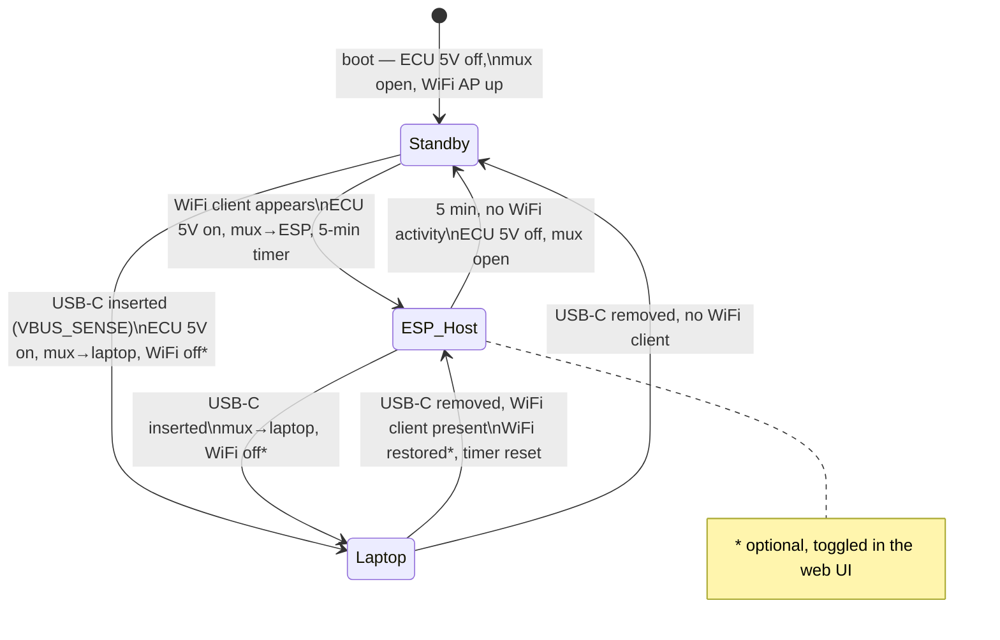

| Stage | Trigger | Board does |
|------:|---------|------------|
| **0, boot / standby** | Power applied from the car | ECU 5V **off**, mux **open** (USB-A floating), WiFi access point **up**. Nothing is pushed onto the ECU's USB until something asks |
| **1, bridge** | A WiFi client appears (joins the access point, opens the web UI, attaches USB/IP) | ECU 5V **on**, mux → **ESP host**; idle timer keeps resetting while in use |
| **2, USB-C in** | Laptop plugged into USB-C (`VBUS_SENSE` HIGH) | ECU 5V **on**, mux → **laptop**; WiFi bridge **off** *(optional)* |
| **3, USB-C out** | USB-C removed (`VBUS_SENSE` LOW) | WiFi bridge **restored** *(optional)*; WiFi client still present → mux → **ESP host**, otherwise back to **standby** |
| **4, idle** | 5 min with no WiFi activity | ECU 5V **off** + mux **open** → ECU sees an unplugged host. The access point stays up; the next WiFi client or USB-C wakes it |

"WiFi activity" = a phone or laptop joined to the access point, a web page request in the last 30 s,
**or** a USB/IP client attached. A **forced route** (USB-C / WiFi in the UI) only fixes *where* the ECU
goes: after a reboot the port still waits in standby for a request, then stays powered (no idle shutdown).

### Status LED (GPIO4)

| Pattern | Meaning |
|---------|---------|
| **Slow flash** (short blip every 1.5 s) | No device connected to USB-A |
| **Double blink** (two short, long gap) | Device connected, no traffic |
| **Fast blink** | Transferring: USB/IP traffic in the last ¾ s |
| **Solid** | Device handed to the laptop over USB-C (ESP not hosting) |
| **Heartbeat** (30 ms blip every 3 s) | Standby: USB-A unpowered, waiting for USB-C or a WiFi client |
| **Strobe** | BOOT held 3 s: factory reset armed, press again to confirm |

---

## The Ignitron gauge protocol

Ignitron's PC software polls the ECU with one vendor control request and reads the answer from bulk-IN
endpoint 1. Every poll cycle is two of these:

| control request (`bmRequestType 0x40, bRequest 0xFA, wIndex 0x0800`) | bulk-IN reply |
|---|---|
| `wValue=2, data[0]=0x09` (9 × 8-byte words) | 8 B header, then **64 B** = channels **0..31** |
| `wValue=3, data[0]=0x59` (89 × 8-byte words) | 8 B header, then **704 B** = channels **32..383** |

Both blocks are plain arrays of little-endian `u16`, one per channel, in the same channel order Ignitron's
own `.ilf` logs use (`Data` block index). No sync word, no checksum: the transfer boundary is the framing.
The 64 B block is the knock/lambda DSP's variables; the 704 B block is everything else.

The channel catalogue itself (name, unit, decimals, multiplier, offset and dial range for all 384
channels, plus the 303 "status bit" definitions) is not reverse-engineered from data at all. It is read
straight out of the installed `Ignitron.exe`, which carries it as a Windows string table
(ID `6000 + channel`, plus `7000 + n` for `name, channel, bit`) and a `float[512][7]` table next to the
code that formats values for the log viewer:

```
engineering = (raw × mult + offset) / 10^decimals     raw = int16 if the display minimum < 0, else uint16
```

`tools/verify_map.py` then checks the whole thing against a real session: a tapcap capture
(`session1.bin`) and the Ignitron log recorded at the same time (`logs/Adam_Forbes_20260914_1842_.ilf`),
paired sample-for-frame on the ECU's own frame counter (channel 347). Result:

| channels | verdict |
|---:|---|
| 144 live | **bit-identical** to the logged value at every paired sample |
| 236 constant | same constant on the wire |
| 4 (32, 381, 382, 383) | computed by the PC into the log (AFR = λ × stoich, USB timing, timestamp); the ECU sends 0 |

and the viewer's displayed values (`tools/ignitron_channels.txt`, transcribed at one cursor) reproduce
from the log's raw values with the exe's table for every channel whose value wasn't jittering between
samples.

Regenerating the firmware table from scratch:

```powershell
py tools/ignitron_exe_extract.py          # Ignitron.exe -> tools/ignitron_channels.csv + ignitron_bits.csv
py tools/verify_map.py LOG.ilf CAPTURE.bin # optional: prove it on a fresh session
py tools/make_channel_map.py               # -> tools/channel_map.csv (keys, groups, defaults)
py tools/gen_gauges.py                     # -> include/gauges_table.h
```

Caveats worth knowing: the exe rewrites a few table rows at runtime from the loaded tune (the CAN torque
channels are re-scaled to the tune's MDI torque value, user-defined sensors get their own calibration),
so those rows carry the compile-time defaults; and the viewer converts km/h to mph when told to, the ECU
always sends km/h.

### Session handshake, tune reads and the "password protect" feature

The same exe read routine that polls live data also does the session start and the tune download, so all
of it is now understood from the code rather than guessed from captures:

- **Session start** (what **Launch Gauges** replays): `E0` read of bank 1 word 0, `E2` reads of bank 1
  words 5 and 0x141, `E4` read of word 0x100, then four `F2` "select address" writes each followed by an
  `E2` 8-byte read at bank 2/3 words 0x40 and 0x140. These are the bootloader/firmware versions of the
  ECU's three processors (bank 1 = COM, 2 = DSP, 3 = CPU; Ignitron's firmware manager prints them as
  byte1.byte0, e.g. CPU firmware V1.28), decoded and shown on the Diagnostics tab. The PC only reads them.
  Then one `FA` write (`wValue 0x0083`, `wIndex 0x0AE8`) whose data stage is the single 16-byte bulk-OUT
  seen in every capture: it clears the host→ECU mailbox that *realtime override* later fills. After that
  the PC polls `FA` continuously; nothing else is needed to keep data flowing.
- **Reply framing, as measured on the wire** (`tools/launch_monitor.py`, `launch.bin`): the ECU streams
  each reply in whole 64-byte packets. The 8 header bytes and the first 56 bytes of the block share the
  first packet, and the tail is padded to a packet boundary with whatever memory follows: 712 → 768 bytes
  for the main block, 72 → 128 for the DSP block. The firmware reads the padded reply as one transfer and
  takes the block from byte 8 (`gauge_poll_task`). Ignitron.exe reads "8 bytes, then the block", which
  only lands aligned because the Windows host drops the rest of that first packet; ESP-IDF hands over the
  whole packet, which is how the first standalone attempt fed the decoder a block shifted by 56 bytes.
- **Obfuscation, not encryption**: the tune (`F9` reads) and the bank-2/3 identity words are XORed with a
  keystream derived from a per-bank constant and the word address (`tools/ignitron_tune.py` has the
  transcription and proof). The live-data blocks are plain. The Vehicle / Owner / Tuner / Notes strings
  are **not** in the ECU at all: every capture was searched raw and decoded, and they only exist in the
  PC-side `.isf` (`tools/isf_parse.py`).
- **Fault memory** (Logging tab → *Read* / *Clear fault memory*), from the exe's parser and a captured
  Ignitron read/clear (`faults1.bin`): the DSP table is 512 B at bank 2 word 0x200 and the CPU table
  1024 B at bank 3 word 0xC00, read with `FB` from the word before each (0x1F8 / 0xBF8, whose bytes 6..7
  are a counter). Tables are 32-byte pages of three 5-word records plus a u16 checksum of the page's other
  30 bytes; a record is `[code, rpm, load ×0.1 %, value, (count−1)<<12 | duration]` and code 0xFFFF is an
  empty slot. Clearing writes 0xFF over both tables (`FB` with `wValue = bank | 0x80`, data as one
  bulk-OUT), reads them back, then commits per bank: `F3` writes `00 00 AA 55 …` at word 0x960 (DSP) /
  0xAE0 (CPU), `F4` + `E4` read it back. Names come from Ignitron's own fault table (`data/faults.js`,
  generated from the exe string table).
- **Password protection** is a set of bits in channel 36 (`Protection against firmware upgrade / ECU
  write / ECU read / reading live data / ...`, see `tools/ignitron_bits.csv`). On this ECU they are all
  clear. The bridge itself is transparent, so a protected ECU still works through Ignitron; the standalone
  gauge poll would be refused by an ECU with *reading live data* protected, and the unlock exchange has
  not been traced.

Status: on hardware (2026-09-15) the identity replay completes and the ECU answers every poll; the
framing fix above is what was missing. When a launch fails, the message beside the button says exactly
why (no ECU found, a USB/IP client attached, or which step got no reply / a stall), and
`tools/launch_monitor.py` records the whole exchange over WiFi and compares it with the PC's session:

```powershell
py tools/launch_monitor.py               # opens the tap, presses Launch, prints every control step
py tools/launch_monitor.py --no-launch   # just watch while Ignitron on the PC opens the session
```

### Raw frame capture

Every ECU transfer (bulk IN/OUT and the vendor control requests that make up the session handshake) is
copied into a record stream. There are two ways to record it, both producing the same file format so all
the `tools/` scripts read either:

**From the dashboard (no software needed)**: *Diagnostics → USB capture*. Press **Start**, do whatever you
want recorded, type a note and **Add** whenever something changes (`idle`, `WOT 3rd`, `AC on`…), press
**Stop**, then **Download .bin**. The recording lives in the browser tab, so stay on the page while it
runs.

**From a laptop**: a second TCP port (`3241`) streams the same records:

```bash
py tools/tapcap.py 192.168.1.1 capture.bin --quiet      # type a note + Enter to mark
nc 192.168.1.1 3241 > capture.bin                        # or just dump it
```

Only one recorder can be attached at a time (the dashboard refuses to start while a TCP client is
connected, and vice versa). Record format, all little-endian: `u8 0xEC, u8 dir (0 OUT / 1 IN / 0xFF
note), u8 ep, u8 flags, u32 t_ms, u16 len, payload[len]`. `tools/gauge_lab.py trace` prints one as a
timeline; `tools/ilf_parse.py` reads the Ignitron `.ilf` logs.

---

## Credits & licence

- USB/IP and USB-host core ported from
  [tiehfood/esphome-usbip-printer](https://github.com/tiehfood/esphome-usbip-printer) (GPL-3.0): printer
  specifics removed, generic vendor-USB support kept.
- Dashboard styling shared with the **Can2Cluster** / **OpenHaldex** projects.

Licensed under **GPL-3.0**: see [`LICENSE`](LICENSE).
